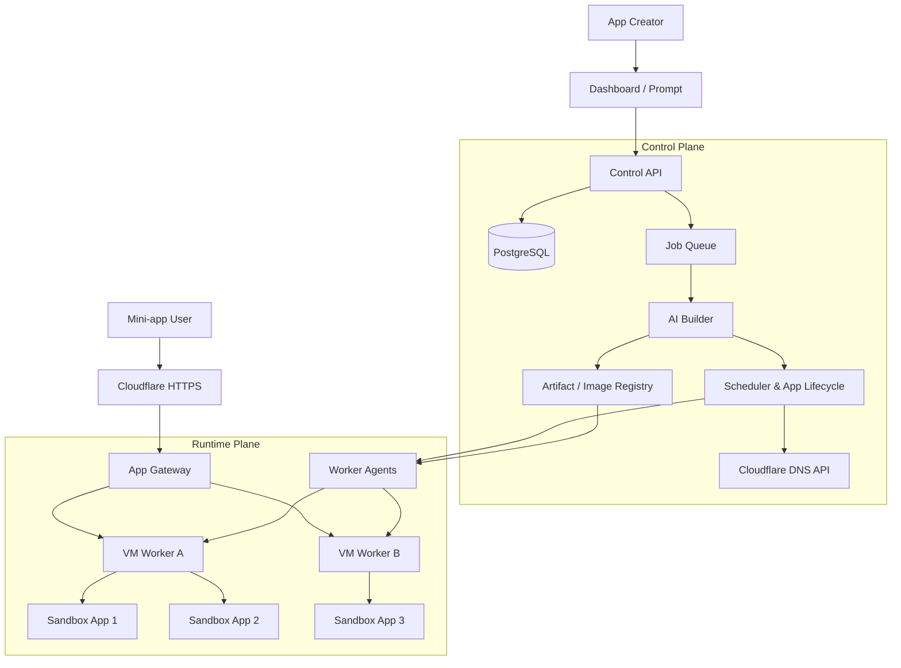

# MinintApp — Architecture Design

[Tiếng Việt](architecture-design.md) | [English](architecture-design.en.md)

## 1. Goals

MinintApp is a SaaS platform that turns natural-language requests into mini-apps ready to use and share. The platform manages builds, data, sandboxes, subdomains, and app lifecycles.

The architecture separates a **Control Plane** that manages the platform from a **Runtime Plane** that runs apps across multiple VMs. Each app has its own sandbox. The demo runs on **one VM with N sandboxes**, preserving the control interfaces needed to expand to multiple VMs.

Subdomains point to a shared gateway. The gateway routes requests to sandboxes, so moving an app between VMs does not require DNS changes.

## 2. Overall architecture



### Proposed stack

| Component | Technology | Responsibility |
|---|---|---|
| Dashboard | Next.js | Prompts, build progress, previews, app management |
| Control API | Node.js / TypeScript | Users, tenants, apps, quotas, domains, lifecycles |
| Metadata | PostgreSQL | Tenants, apps, versions, deployments, workers |
| Job queue | Redis + BullMQ | Builds, deployments, retries, expiration |
| AI Builder | Worker calling Codex | Generate code from templates, build, and validate |
| Gateway | Traefik | Route hostnames to sandboxes; support WebSocket |
| Worker Agent | Dedicated service on each VM | Create, stop, inspect, and reclaim sandboxes |
| Sandbox | Docker with gVisor `runsc` runtime | Isolate each app's workload |
| Artifact | OCI registry + S3-compatible storage | Images, source, backups, build logs |

gVisor provides an application kernel to isolate untrusted code and integrates with Docker or Kubernetes. Validate the app template against this runtime before finalizing the execution environment.

## 3. From prompt to running app

Example: “Create a workshop voting app with five candidates and one vote per person.”

1. **Create the app:** assign an `app_id`, owner, slug, and expiration time.
2. **Create an App Spec:** AI describes the interface, data, functionality, and resource limits.
3. **Generate and build code:** the Builder uses a fixed template and builds in a separate temporary sandbox.
4. **Validate:** confirm a successful build, perform health checks, and exercise the main user flow.
5. **Select a VM:** the Scheduler considers available and already reserved resources.
6. **Create the runtime:** the Worker Agent creates a sandbox with the app's image, volume, and secrets.
7. **Publish:** register the route, create DNS through the Cloudflare API, and verify HTTPS access.
8. **Return the link:** for example, `workshop-abc.minintapps.com`.

An app enters `RUNNING` only after access through the gateway succeeds. Domains in this document are examples; replace them with an owned domain and configure TLS at both the edge and origin before the demo.

```text
QUEUED → GENERATING → BUILDING → DEPLOYING → RUNNING
                         ↓           ↓
                       FAILED      FAILED

RUNNING → SUSPENDED → RUNNING
RUNNING → EXPIRED → DELETED
```

Jobs must be idempotent: retries must not create duplicate sandboxes or DNS records. Each deployment references a specific image version to support rollback.

## 4. Subdomains through the Cloudflare API

Each publication creates a record:

```text
Type:     CNAME
Name:     workshop-abc
Target:   ingress.minintapps.com
Proxied:  true
```

`ingress.minintapps.com` points to the gateway or load balancer. The Control Plane stores `dns_record_id` to update or delete the record when reclaiming the app. The Cloudflare token stays exclusively in the Control Plane and has minimal permissions on the managed zone.

The gateway maintains this mapping:

```text
workshop-abc.minintapps.com
    → deployment_123
    → worker_01
    → sandbox_ip:3000
```

When moving an app to another VM, update the route after the new runtime is ready; DNS continues pointing to the shared ingress. Unregistered hostnames or stopped apps must return an appropriate status page rather than route to a default app.

At larger scale, wildcard DNS (`*.minintapps.com`) can reduce DNS operations. The demo creates individual records through the API to demonstrate automated provisioning.

AI-generated apps must run on a domain separate from the dashboard domain. Dashboard authentication cookies must be scoped to the exact dashboard hostname and must not be shared with apps through a parent domain.

## 5. Per-app sandboxes and data

**One app = one runtime sandbox + one dedicated data volume.** Builds use a separate temporary sandbox that is destroyed afterward. AI-generated code is treated as an untrusted workload.

| Property | Initial policy |
|---|---|
| CPU / RAM | For example, 0.5 vCPU / 512 MiB per app; validate in the demo |
| Process | Run as non-root; enforce PID limits |
| Filesystem | Read-only root filesystem; only `/data` is writable |
| Privileges | Drop Linux capabilities; no privileged mode |
| Network | Block the control plane, metadata service, and other sandboxes; control egress |
| Secrets | Provide only secrets belonging to the app |
| Host access | Never mount the Docker socket or host directories into an app |
| TTL | Stop expired apps, retain data according to policy, then delete it |

The Worker Agent is privileged and accepts only authenticated Control Plane requests over a private network. Apps cannot access the sandbox management API.

### MVP data storage

Use SQLite on a dedicated volume for temporary apps with **one replica per app**. Moving an app between workers requires stopping it, taking a snapshot, and transferring its volume before restarting. Backups must preserve SQLite consistency.

If an app needs multiple replicas, move to PostgreSQL with a dedicated database/role per app or a data service with access controls. Never expose shared database administrator credentials to AI-generated code.

SaaS metadata in PostgreSQL is always associated with a tenant. The Control API checks ownership when reading or changing apps, deployments, domains, and related data.

## 6. Demo: one VM, N sandboxes

```text
Demo VM
├── Dashboard + Control API
├── PostgreSQL
├── Redis + Build Worker
├── Traefik Gateway
├── Scheduler + Worker Agent
├── Temporary build sandbox
├── App A sandbox + volume A
├── App B sandbox + volume B
└── App C sandbox + volume C
```

Proposed trial configuration: **Linux VM with 8 vCPU / 16 GB RAM**, limited to **one concurrent build** and a few lightweight apps. This is an initial assumption rather than a capacity guarantee; measure against the template and traffic while reserving resources for platform services.

### Demo scenario

1. Prompt for a voting app and receive a working HTTPS subdomain.
2. Create an event registration app in a second sandbox.
3. Stop or crash the first app; the second app continues running.
4. Expire an app; the gateway stops serving it and its sandbox is reclaimed.

A single VM remains a shared point of failure. The demo demonstrates isolation between apps, not resilience to VM failure.

## 7. Scaling to multiple VMs

Preserve the Scheduler–Worker Agent interface; adding workers adds app execution capacity.

- **Control Plane:** deploy separately with managed database and queue services.
- **Runtime Plane:** multiple VMs run only agents and sandboxes.
- **Gateway:** multiple instances behind a load balancer receive routes from the deployment registry.
- **Scheduler:** monitor heartbeats, reserve resources, and stop assigning apps to disconnected workers.
- **Recovery:** recreate apps from images and data backups; local volumes do not automatically follow apps.
- **Observability:** collect app/deployment logs, build status, CPU/RAM usage, runtime errors, and administrative activity.

Each app still has one replica at this stage. After a worker failure, confirm that the old runtime can no longer write data before restoring a writable instance on another worker.

## 8. Seven-hour hackathon scope

- One validated full-stack template.
- One replica per app, SQLite, and a dedicated volume.
- Real subdomain creation through the Cloudflare API.
- Separate gVisor sandboxes for each app and build.
- Start, stop, status, logs, and TTL management.
- A Worker Agent interface designed for multiple VMs.

Automatic VM provisioning, cross-VM recovery, and multiple replicas per app belong to later phases. This document is a proposed design; the repository does not yet implement these components.

## 9. References

- [Cloudflare DNS API](https://developers.cloudflare.com/api/resources/dns/)
- [Cloudflare wildcard DNS records](https://developers.cloudflare.com/dns/manage-dns-records/reference/wildcard-dns-records/)
- [gVisor architecture and security introduction](https://gvisor.dev/docs/architecture_guide/intro/)
