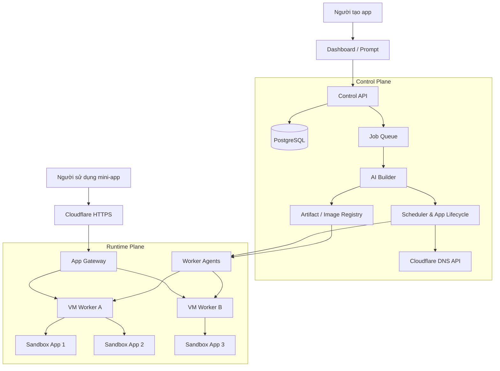

# MinintApp — Thiết kế kiến trúc

[Tiếng Việt](architecture-design.md) | [English](architecture-design.en.md)

## 1. Mục tiêu

MinintApp là nền tảng SaaS cho phép người dùng mô tả nhu cầu bằng ngôn ngữ tự nhiên để tạo mini-app có thể sử dụng và chia sẻ ngay. Nền tảng tự quản lý build, dữ liệu, sandbox, subdomain và vòng đời app.

Kiến trúc tách thành **Control Plane** quản lý toàn hệ thống và **Runtime Plane** chạy app trên nhiều VM. Mỗi app có sandbox riêng. Bản demo triển khai trên **1 VM với N sandbox**, giữ nguyên giao diện điều khiển để mở rộng sang nhiều VM.

Subdomain trỏ vào gateway chung. Gateway định tuyến đến sandbox, vì vậy chuyển app giữa các VM không yêu cầu thay đổi DNS.

## 2. Kiến trúc tổng thể



### Stack đề xuất

| Thành phần | Công nghệ | Trách nhiệm |
|---|---|---|
| Dashboard | Next.js | Prompt, tiến độ build, preview, quản lý app |
| Control API | Node.js / TypeScript | User, tenant, app, quota, domain, vòng đời |
| Metadata | PostgreSQL | Tenant, app, version, deployment, worker |
| Job queue | Redis + BullMQ | Build, deploy, retry, hết hạn |
| AI Builder | Worker gọi Codex | Sinh code theo template, build và kiểm tra |
| Gateway | Traefik | Route hostname đến sandbox, hỗ trợ WebSocket |
| Worker Agent | Service riêng trên mỗi VM | Tạo, dừng, kiểm tra và thu hồi sandbox |
| Sandbox | Docker với runtime gVisor `runsc` | Cách ly workload của từng app |
| Artifact | OCI registry + S3-compatible storage | Image, source, backup và log build |

gVisor bổ sung application kernel để cách ly code không đáng tin cậy và tích hợp được với Docker hoặc Kubernetes. Cần kiểm tra template app với runtime này trước khi chốt môi trường chạy.

## 3. Luồng từ prompt đến app hoạt động

Ví dụ: “Tạo app bình chọn workshop, 5 ứng viên, mỗi người vote một lần.”

1. **Tạo app:** cấp `app_id`, chủ sở hữu, slug và thời hạn sử dụng.
2. **Tạo App Spec:** AI mô tả giao diện, dữ liệu, chức năng và giới hạn tài nguyên.
3. **Sinh code và build:** Builder dùng template cố định, chạy build trong sandbox tạm riêng.
4. **Kiểm tra:** xác nhận build thành công, health check và thử luồng chính.
5. **Chọn VM:** Scheduler xét tài nguyên còn trống và tài nguyên đã đặt trước.
6. **Tạo runtime:** Worker Agent tạo sandbox, gắn image, volume và secret riêng của app.
7. **Publish:** đăng ký route, tạo DNS qua Cloudflare API và kiểm tra truy cập HTTPS.
8. **Trả link:** ví dụ `workshop-abc.minintapps.com`.

App chỉ chuyển sang `RUNNING` sau khi truy cập qua gateway thành công. Các domain trong tài liệu là ví dụ; cần thay bằng domain đã sở hữu và cấu hình TLS ở cả edge lẫn origin trước khi demo.

```text
QUEUED → GENERATING → BUILDING → DEPLOYING → RUNNING
                         ↓           ↓
                       FAILED      FAILED

RUNNING → SUSPENDED → RUNNING
RUNNING → EXPIRED → DELETED
```

Các job phải idempotent: retry không tạo thêm sandbox hoặc DNS record trùng. Mỗi deployment tham chiếu một phiên bản image cụ thể để có thể rollback.

## 4. Subdomain qua Cloudflare API

Mỗi lần publish tạo một record:

```text
Type:     CNAME
Name:     workshop-abc
Target:   ingress.minintapps.com
Proxied:  true
```

`ingress.minintapps.com` trỏ đến gateway hoặc load balancer. Control Plane lưu `dns_record_id` để cập nhật và xóa record khi thu hồi app. Token Cloudflare chỉ nằm trong Control Plane, có quyền tối thiểu trên zone cần quản lý.

Gateway giữ ánh xạ:

```text
workshop-abc.minintapps.com
    → deployment_123
    → worker_01
    → sandbox_ip:3000
```

Khi chuyển app sang VM khác, cập nhật route sau khi runtime mới sẵn sàng; DNS vẫn trỏ vào ingress chung. Hostname chưa được đăng ký hoặc app đã ngừng chạy phải trả trang trạng thái phù hợp, không route vào app mặc định.

Khi quy mô tăng, có thể dùng wildcard `*.minintapps.com` để giảm thao tác DNS. Bản demo tạo từng record thật qua API nhằm thể hiện provisioning tự động.

Domain chạy app do AI sinh cần tách khỏi domain dashboard. Cookie đăng nhập dashboard chỉ đặt cho đúng hostname dashboard, không chia sẻ qua domain cha với các app.

## 5. Sandbox và dữ liệu mỗi app

**Một app = một sandbox runtime + một volume dữ liệu riêng.** Sandbox build là sandbox tạm khác và được hủy sau build. Code do AI sinh được coi là workload không đáng tin cậy.

| Thuộc tính | Chính sách khởi đầu |
|---|---|
| CPU / RAM | Ví dụ 0,5 vCPU / 512 MiB mỗi app; đo lại bằng demo |
| Process | Chạy non-root, giới hạn PID |
| Filesystem | Root filesystem chỉ đọc; chỉ `/data` được ghi |
| Quyền | Bỏ Linux capabilities, không privileged |
| Network | Chặn control plane, metadata service và sandbox khác; kiểm soát egress |
| Secret | Chỉ cấp secret thuộc app đó |
| Host access | Không mount Docker socket hoặc thư mục host vào app |
| TTL | Đến hạn dừng app, giữ dữ liệu theo chính sách rồi mới xóa |

Worker Agent là thành phần có đặc quyền, chỉ nhận yêu cầu đã xác thực từ Control Plane qua mạng riêng. App không được truy cập API quản lý sandbox.

### Dữ liệu MVP

Dùng SQLite trên volume riêng, phù hợp với app tạm thời và **một replica/app**. Khi chuyển worker, cần dừng app, snapshot và chuyển volume trước khi chạy lại. Việc sao lưu phải bảo đảm tính nhất quán của SQLite.

Nếu cần nhiều replica cho một app, chuyển sang PostgreSQL với database/role riêng theo app hoặc dịch vụ dữ liệu có kiểm soát quyền. Không đưa credential quản trị database chung vào code do AI tạo.

Metadata SaaS trong PostgreSQL luôn gắn với tenant. Control API kiểm tra quyền sở hữu khi đọc hoặc thay đổi app, deployment, domain và dữ liệu liên quan.

## 6. Demo: 1 VM, N sandbox

```text
VM demo
├── Dashboard + Control API
├── PostgreSQL
├── Redis + Build Worker
├── Traefik Gateway
├── Scheduler + Worker Agent
├── Build sandbox tạm
├── App A sandbox + volume A
├── App B sandbox + volume B
└── App C sandbox + volume C
```

Cấu hình thử nghiệm đề xuất: **VM Linux 8 vCPU / 16 GB RAM**, giới hạn **một build đồng thời** và vài app nhẹ. Đây là giả định khởi đầu, không phải cam kết sức chứa; cần đo theo template và tải truy cập, đồng thời dành tài nguyên cho dịch vụ nền.

### Kịch bản demo

1. Prompt tạo app bình chọn và nhận subdomain HTTPS hoạt động.
2. Tạo app đăng ký sự kiện trong sandbox thứ hai.
3. Dừng hoặc gây lỗi app thứ nhất; app thứ hai vẫn hoạt động.
4. Cho app hết hạn; gateway ngừng phục vụ và sandbox được thu hồi.

Một VM vẫn là điểm lỗi chung. Demo chứng minh cách ly giữa các app, chưa chứng minh khả năng chịu lỗi khi VM chết.

## 7. Mở rộng sang nhiều VM

Giữ nguyên giao tiếp giữa Scheduler và Worker Agent; thêm worker tạo thêm năng lực chạy app.

- **Control Plane:** triển khai riêng, dùng database và queue được quản lý.
- **Runtime Plane:** nhiều VM chỉ chạy agent và sandbox.
- **Gateway:** nhiều instance phía sau load balancer, nhận route từ deployment registry.
- **Scheduler:** theo dõi heartbeat, đặt trước tài nguyên và ngừng cấp app cho worker mất kết nối.
- **Recovery:** dựng lại app từ image và bản sao dữ liệu; volume cục bộ không tự di chuyển theo app.
- **Observability:** thu thập log theo app/deployment, trạng thái build, CPU/RAM, lỗi runtime và hoạt động quản trị.

Mỗi app trong giai đoạn này vẫn có một replica. Khi worker lỗi, cần xác nhận runtime cũ không còn ghi dữ liệu trước khi phục hồi một instance có quyền ghi ở worker mới.

## 8. Phạm vi hackathon 7 giờ

- Một template full-stack được kiểm chứng.
- Một replica/app, SQLite và volume riêng.
- Tạo subdomain thật qua Cloudflare API.
- Sandbox gVisor riêng cho từng app và build.
- Quản lý start, stop, trạng thái, log và TTL.
- Thiết kế giao diện Worker Agent để mở rộng đa VM.

Tự động cấp VM, phục hồi liên VM và chạy nhiều replica/app thuộc giai đoạn sau. Kiến trúc trên là thiết kế đề xuất; repo chưa có phần triển khai các thành phần này.

## 9. Tài liệu tham chiếu

- [Cloudflare DNS API](https://developers.cloudflare.com/api/resources/dns/)
- [Cloudflare wildcard DNS records](https://developers.cloudflare.com/dns/manage-dns-records/reference/wildcard-dns-records/)
- [gVisor architecture and security introduction](https://gvisor.dev/docs/architecture_guide/intro/)
