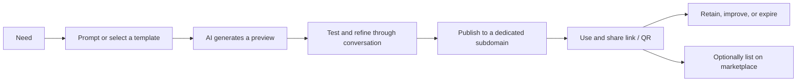

# MinintApp — Product Direction and Business Flow

[Tiếng Việt](business-flow.md) | [English](business-flow.en.md)

## 1. Positioning

**MinintApp is an all-in-one platform where anyone can create, run, use, share, and sell AI-generated Flash Apps.**

Users describe a need, receive a working app with its own data and URL, improve it through conversation, and optionally list it on a marketplace for others to discover, use, or buy the right to create their own copy. MinintApp provides creation tools, runtime infrastructure, distribution, and creator monetization.

Message: **Turn a need into an app. Turn an app into a business opportunity.**

“Temporary problem. Temporary software.” remains the starting point: create an app when needed. Useful apps can be retained, reused, and developed into products sold on the platform; expiration is optional.

## 2. Flash Apps on MinintApp

A Flash App is a small, interactive application created or modified through natural-language instructions and used directly on MinintApp. Depending on its functionality, it can persist data, perform calculations, display charts, and serve multiple users.

| Concept | Role |
|---|---|
| Flash App on MinintApp | AI-driven app creation, usage, and distribution within one platform |
| Mini-app | A small application format; not necessarily AI-generated |
| WeChat Mini Program | An application running within the WeChat ecosystem |
| Quick App | An application model tied to devices supporting the Quick App ecosystem |

Ant Group's LingGuang is an inspiration for turning prompts into Flash Apps. An Ant Group announcement describes creating Flash Apps from a single prompt. The marketplace and commercial mechanisms below are **MinintApp proposals**, not verified descriptions of LingGuang features. Advertised app counts, creator counts, or generation times are not MinintApp commitments.

## 3. Users and value

| Audience | Need | Value |
|---|---|---|
| Individuals | Tools for specific tasks | Create or discover an app and use it immediately |
| Organizers, teachers, small teams | Voting, registration, task tracking | Share links/QR codes without operating servers |
| Creators | Turn domain knowledge into products | Build apps, distribute them, gain customers and revenue |
| Buyers / small businesses | Ready-made, customizable tools | Buy the right to create a private copy and adapt it |
| MinintApp | Build a sustainable ecosystem | Platform and transaction revenue with controlled operating costs |

A user can also become a creator. Initially, prioritize workshop communities, education, and small teams with simple data workflows that are easy to demonstrate.

## 4. App creation and operation flow



1. The user signs in and describes the purpose, required data, and intended audience.
2. MinintApp creates a preview and displays functionality and usage limits. If payment is required, show the cost before confirmation.
3. The user tests the app and requests changes through conversation.
4. On publication, the platform provisions a sandbox, dedicated data, and an HTTPS subdomain, returning a shareable link/QR code.
5. The owner manages status, versions, data, expiration, and costs in the dashboard.
6. The owner can extend, stop, export data from, or delete the app under the published retention policy.

Private apps do not automatically appear on the marketplace. Sharing a running app and listing a product for sale are independent actions.

## 5. Marketplace and transaction flows

**The initial transaction model sells the right to create a dedicated app instance from a creator's released version.** Buyers receive their own instance and data on MinintApp. This is not an exclusive transfer of the original app or an automatic source-code purchase.

### Creator flow

1. Build and test an app on the platform.
2. Select a version to list; add a description, images, a demo using sample data, a category, and instructions.
3. Choose free or paid distribution; disclose price, usage rights, modification/remix rights, support, update policy, and refunds.
4. Submit for review. MinintApp checks functionality, content, distribution rights, and requested data access before public listing.
5. Track usage, purchases, feedback, and revenue; release new versions when needed.

### Buyer flow

1. Discover apps through needs, categories, search, or creator pages.
2. Try a demo using sample data; review the purchase price and operating costs separately.
3. Confirm a purchase or select a free app. Grant paid access only after successful payment; repeated callbacks must not duplicate orders or entitlements.
4. Select “Create my copy”: the platform provisions an app, sandbox, dedicated data, and subdomain from the acquired version.
5. Customize through prompts within the license terms; use and share the resulting instance.
6. Review the product, request support, or request a refund under the published policy.

**Never copy a creator's production data, secrets, or user lists into a buyer's instance.** Purchasing an app does not automatically grant resale rights. Public or commercial remixes require an appropriate license and attribution where required.

### Updates and revenue

- Listings reference specific versions. Creator updates never automatically overwrite buyers' instances; upgrades require opt-in and data protection before application.
- Record sale price, platform fees, payment costs, refunds, and creator proceeds in a transaction ledger.
- Creator earnings move from pending to withdrawable under disclosed timing and conditions; payouts use a payment provider with reconciliation and dispute handling.
- Delisting prevents new purchases; treatment of existing entitlements and running instances must be disclosed before purchase.

## 6. Community loop

```text
Creators build useful apps
    → Marketplace enables discovery
    → Users use / buy / create their own instances
    → Feedback and revenue encourage improvements
    → Licensed remixes produce additional products
    → The community gains more useful apps
```

Creator profiles, collections organized around needs, reviews from actual users, and remix attribution support community growth. Rankings should reward working, useful apps; generation counts alone do not measure product value.

## 7. Proposed revenue model

| Revenue stream | Approach |
|---|---|
| Subscriptions | Included generation/editing limits, active apps, and resources |
| Additional credits | Extra AI usage or resources, priced before purchase |
| Marketplace fees | Percentage of successful transactions; rate determined after testing |
| Team / business plans | Workspaces, permissions, quotas, and enhanced support in later phases |

The app purchase pays for rights to a creator's product; operating fees pay for platform infrastructure and AI. Present both clearly, even when bundled. A one-time template purchase must not imply lifetime hosting.

Prices and revenue-sharing rates are not finalized. Measure AI, build, runtime, storage, bandwidth, payment, and support costs to validate margins before broad commercial availability.

## 8. MVP, demo, and roadmap

| Phase | Scope |
|---|---|
| Seven-hour hackathon demo | Prompt → preview → edit → publish; one VM, N sandboxes; sample marketplace with categories and free instance creation |
| Community pilot | Creator profiles, reviewed listings, search, feedback, explicit versions and licenses |
| Commerce beta | Real payments, entitlements, platform fees, refunds, transaction ledger, payouts |
| Expansion | Multiple VMs, cost visibility, creator analytics, team workspaces, licensed remixing |

If the demo includes a purchase screen, label the transaction as simulated. Do not present payments or payouts as operational before real integration.

Demo scenario: create a workshop voting app → share its subdomain → publish a free template on the marketplace → another account creates a copy with empty data → customize it for another workshop. The two apps run in separate sandboxes; stopping one leaves the other running.

## 9. Metrics

- Time from prompt to first successful use; successful publication rate.
- Apps with real users and weekly returning active creators.
- Listing view → demo trial → instance creation or purchase conversion.
- GMV, net platform revenue, creator earnings, and refund rate once commerce launches.
- Cost per active app and successful generation; contribution margin after AI, infrastructure, and transaction costs.

## 10. Architecture implications

The [architecture design](architecture-design.en.md) provides the Control Plane, sandboxes, domains, and lifecycle management. Marketplace support adds `CreatorProfile`, `Listing`, `ListingVersion`, `License`, `Order`, `Entitlement`, `LedgerEntry`, `Payout`, and `Review` entities.

Distinguish a running `App`, a distributable `Listing`, and an `Entitlement` representing acquired rights. One listing can create independent apps for multiple buyers. Granting commercial rights does not imply successful sandbox provisioning; provisioning failures must be retryable without charging again.

This document describes proposed product direction and workflows, not features already implemented in the repository.

## 11. References

- [LingGuang](https://www.lingguang.com/)
- [Ant Group announcement on LingGuang 2.0, distributed through Business Wire](https://via.ritzau.dk/pressemeddelelse/15250120/ant-group-upgrades-lingguang-to-20-turning-its-ai-assistant-into-a-proactive-personal-agent?lang=en&publisherId=90456): reference for prompt-based Flash App creation, not evidence of MinintApp's proposed marketplace model.
