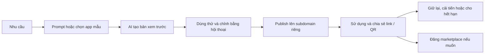

# MinintApp — Định hướng sản phẩm và Business Flow

[Tiếng Việt](business-flow.md) | [English](business-flow.en.md)

## 1. Định vị

**MinintApp là nền tảng all-in-one để mọi người tạo, vận hành, sử dụng, chia sẻ và kinh doanh Flash App bằng AI.**

Người dùng mô tả nhu cầu, nhận app hoạt động với dữ liệu và đường dẫn riêng, cải tiến bằng hội thoại, rồi có thể đưa app lên marketplace để cộng đồng khám phá, sử dụng hoặc mua quyền tạo bản riêng. MinintApp cung cấp cả công cụ sáng tạo, hạ tầng vận hành, kênh phân phối và cơ chế kiếm tiền cho creator.

Thông điệp: **Từ một nhu cầu đến một ứng dụng. Từ một ứng dụng đến một cơ hội kinh doanh.**

“Temporary problem. Temporary software.” vẫn là điểm khởi đầu: tạo app ngay khi cần. App hữu ích có thể được giữ lại, tái sử dụng và phát triển thành sản phẩm bán trên nền tảng; không bắt buộc phải biến mất.

## 2. Flash App trong MinintApp

Flash App là ứng dụng nhỏ, tương tác được, được tạo hoặc chỉnh sửa từ mô tả bằng ngôn ngữ tự nhiên và sử dụng ngay trên MinintApp. Tùy chức năng, app có thể lưu dữ liệu, tính toán, hiển thị biểu đồ và phục vụ nhiều người dùng.

| Khái niệm | Vai trò |
|---|---|
| Flash App trên MinintApp | Mô hình tạo, sử dụng và phân phối app bằng AI trong cùng nền tảng |
| Mini-app | Dạng ứng dụng nhỏ; không tự hàm ý được tạo bằng AI |
| WeChat Mini Program | Ứng dụng chạy trong hệ sinh thái WeChat |
| Quick App | Mô hình ứng dụng gắn với hệ sinh thái thiết bị hỗ trợ Quick App |

LingGuang của Ant Group là nguồn cảm hứng về việc biến prompt thành Flash App. Thông cáo của Ant Group mô tả khả năng tạo Flash App từ một prompt. Marketplace và cơ chế thương mại dưới đây là **đề xuất riêng cho MinintApp**, không phải mô tả tính năng đã xác minh của LingGuang. Không dùng số lượng app, creator hoặc thời gian tạo app được quảng bá làm cam kết của MinintApp.

## 3. Người dùng và giá trị

| Nhóm | Nhu cầu | Giá trị nhận được |
|---|---|---|
| Người dùng cá nhân | Công cụ phù hợp việc cụ thể | Tạo hoặc tìm app và dùng ngay |
| Người tổ chức, giáo viên, nhóm nhỏ | Bình chọn, đăng ký, theo dõi công việc | Chia sẻ qua link/QR, không tự vận hành server |
| Creator | Biến kinh nghiệm nghiệp vụ thành sản phẩm | Tạo app, phân phối, có khách hàng và doanh thu |
| Người mua / doanh nghiệp nhỏ | Công cụ đã có sẵn, dễ tùy chỉnh | Mua quyền tạo bản riêng và sửa theo nhu cầu |
| MinintApp | Phát triển hệ sinh thái bền vững | Doanh thu nền tảng và giao dịch, có kiểm soát chi phí vận hành |

Một người có thể vừa sử dụng app vừa trở thành creator. Giai đoạn đầu ưu tiên cộng đồng workshop, giáo dục và nhóm nhỏ, với các bài toán dữ liệu đơn giản, dễ trình diễn.

## 4. Luồng tạo và vận hành app



1. Người dùng đăng nhập, mô tả mục đích, dữ liệu cần lưu và người sẽ sử dụng.
2. MinintApp tạo bản xem trước, hiển thị chức năng và hạn mức sử dụng. Khi cần trả phí, hiển thị chi phí trước khi người dùng xác nhận.
3. Người dùng thử app và yêu cầu sửa bằng hội thoại.
4. Khi publish, nền tảng tạo sandbox, dữ liệu riêng và subdomain HTTPS; người dùng nhận link/QR để chia sẻ.
5. Chủ app quản lý trạng thái, phiên bản, dữ liệu, thời hạn và chi phí trong dashboard.
6. Chủ app có thể gia hạn, dừng, xuất dữ liệu hoặc xóa app theo chính sách lưu giữ được công bố.

App riêng tư không tự xuất hiện trên marketplace. Chia sẻ một app đang chạy và đăng sản phẩm bán là hai hành động độc lập.

## 5. Marketplace và luồng mua bán

**Mô hình giao dịch đầu tiên: bán quyền tạo một bản app riêng từ phiên bản đã được creator phát hành.** Người mua nhận instance và dữ liệu riêng, chạy trên MinintApp; đây không phải chuyển nhượng độc quyền app gốc hoặc mặc định mua mã nguồn.

### Luồng creator

1. Tạo và kiểm thử app bằng chính nền tảng.
2. Chọn phiên bản để niêm yết; thêm mô tả, ảnh, demo bằng dữ liệu mẫu, danh mục và hướng dẫn.
3. Chọn miễn phí hoặc trả phí; công bố giá, quyền sử dụng, quyền chỉnh sửa/remix, hỗ trợ, chính sách cập nhật và hoàn tiền.
4. Gửi duyệt. MinintApp kiểm tra chức năng, nội dung, quyền phân phối và yêu cầu truy cập dữ liệu trước khi hiển thị công khai.
5. Theo dõi lượt dùng, đơn mua, phản hồi và doanh thu; phát hành phiên bản mới khi cần.

### Luồng người mua

1. Khám phá theo nhu cầu, danh mục, tìm kiếm hoặc trang creator.
2. Xem demo với dữ liệu mẫu; đọc giá mua và chi phí vận hành riêng biệt.
3. Xác nhận mua hoặc chọn app miễn phí. Thanh toán thành công mới cấp quyền; xử lý callback lặp không tạo đơn hoặc quyền trùng.
4. Chọn “Tạo bản của tôi”: nền tảng tạo app, sandbox, dữ liệu và subdomain riêng từ phiên bản đã mua.
5. Tùy chỉnh bằng prompt trong phạm vi license; sử dụng và chia sẻ bản của mình.
6. Đánh giá, yêu cầu hỗ trợ hoặc hoàn tiền theo chính sách.

**Không sao chép dữ liệu thật, secret hoặc danh sách người dùng của creator sang bản người mua.** Mua app không mặc định cho phép bán lại. Remix công khai hoặc thương mại chỉ được thực hiện nếu license cho phép, có ghi nguồn theo điều kiện tương ứng.

### Cập nhật và doanh thu

- Listing tham chiếu phiên bản cụ thể. Bản người mua không tự bị ghi đè khi creator cập nhật; cần chọn nâng cấp và bảo vệ dữ liệu trước khi áp dụng.
- Thanh toán ghi nhận giá bán, phí nền tảng, chi phí thanh toán, khoản hoàn tiền và phần creator nhận trong sổ giao dịch.
- Tiền creator chuyển từ chờ xử lý sang có thể rút theo thời hạn và điều kiện đã công bố; payout qua nhà cung cấp thanh toán, có đối soát và xử lý tranh chấp.
- Gỡ listing ngăn mua mới; cách xử lý quyền đã mua và instance đang chạy phải được công bố trước giao dịch.

## 6. Vòng lặp cộng đồng

```text
Creator tạo app hữu ích
    → Marketplace giúp người khác khám phá
    → Người dùng sử dụng / mua / tạo bản riêng
    → Phản hồi và doanh thu khuyến khích creator cải tiến
    → Remix được cấp phép tạo thêm sản phẩm
    → Cộng đồng có thêm app hữu ích
```

Hồ sơ creator, bộ sưu tập theo tình huống, đánh giá từ người dùng thực và ghi nguồn remix giúp phát triển cộng đồng. Xếp hạng ưu tiên app dùng được và có ích; số app được sinh ra đơn thuần chưa phản ánh giá trị sản phẩm.

## 7. Mô hình doanh thu đề xuất

| Nguồn thu | Cách áp dụng |
|---|---|
| Gói thuê bao | Hạn mức tạo/chỉnh sửa, số app hoạt động và tài nguyên được bao gồm |
| Credit bổ sung | Lượt AI hoặc tài nguyên vượt hạn mức, giá hiển thị trước |
| Phí marketplace | Phần trăm giao dịch thành công; tỷ lệ xác định sau thử nghiệm |
| Gói nhóm / doanh nghiệp | Workspace, phân quyền, quota và hỗ trợ nâng cao ở giai đoạn sau |

Giá mua app trả cho quyền sử dụng sản phẩm của creator; phí vận hành trả cho hạ tầng và AI của nền tảng. Hai khoản phải được trình bày rõ, kể cả khi được gộp thành một gói. Không hứa vận hành trọn đời chỉ từ một khoản mua template.

Chưa chốt giá hoặc tỷ lệ chia sẻ doanh thu. Cần đo chi phí AI, build, runtime, storage, băng thông, thanh toán và hỗ trợ để kiểm tra biên lợi nhuận trước khi mở bán rộng rãi.

## 8. MVP, demo và lộ trình

| Giai đoạn | Phạm vi |
|---|---|
| Demo hackathon 7 giờ | Prompt → preview → chỉnh sửa → publish; 1 VM, N sandbox; marketplace mẫu có danh mục và tạo bản riêng miễn phí |
| Thử nghiệm cộng đồng | Creator profile, niêm yết có duyệt, tìm kiếm, phản hồi, version và license rõ ràng |
| Commerce beta | Thanh toán thật, cấp quyền, phí nền tảng, hoàn tiền, sổ giao dịch và payout |
| Mở rộng | Nhiều VM, quan sát chi phí, creator analytics, workspace nhóm, remix có cấp phép |

Nếu demo có màn hình mua app, phải ghi rõ giao dịch mô phỏng; không mô tả thanh toán hoặc payout là đã hoạt động khi chưa tích hợp thật.

Kịch bản demo: tạo app bình chọn workshop → chia sẻ subdomain → đăng bản mẫu miễn phí lên marketplace → tài khoản khác tạo bản riêng với dữ liệu trống → tùy chỉnh cho một workshop khác. Hai app chạy trong hai sandbox độc lập; dừng một app không làm app còn lại ngừng hoạt động.

## 9. Chỉ số cần theo dõi

- Thời gian từ prompt đến lần sử dụng thành công đầu tiên; tỷ lệ publish thành công.
- Số app có người dùng thực và creator quay lại hoạt động hàng tuần.
- Tỷ lệ xem listing → thử demo → tạo bản riêng hoặc mua.
- GMV, doanh thu thuần nền tảng, thu nhập creator và tỷ lệ hoàn tiền khi mở commerce.
- Chi phí mỗi app hoạt động và mỗi lần tạo thành công; biên đóng góp sau AI, hạ tầng và chi phí giao dịch.

## 10. Liên hệ với kiến trúc

[Thiết kế kiến trúc](architecture-design.md) cung cấp Control Plane, sandbox, domain và vòng đời. Để hỗ trợ marketplace, bổ sung các thực thể `CreatorProfile`, `Listing`, `ListingVersion`, `License`, `Order`, `Entitlement`, `LedgerEntry`, `Payout` và `Review`.

Phân biệt `App` đang chạy, `Listing` để phân phối và `Entitlement` thể hiện quyền đã nhận/mua. Một listing có thể tạo nhiều app độc lập cho nhiều người mua. Cấp quyền thương mại không đồng nghĩa sandbox đã được khởi tạo thành công; nếu provisioning lỗi, cho phép retry mà không thu tiền lại.

Đây là định hướng sản phẩm và luồng đề xuất, chưa phải các tính năng đã triển khai trong repo.

## 11. Tham khảo

- [LingGuang](https://www.lingguang.com/)
- [Thông cáo Ant Group về LingGuang 2.0, phát hành qua Business Wire](https://via.ritzau.dk/pressemeddelelse/15250120/ant-group-upgrades-lingguang-to-20-turning-its-ai-assistant-into-a-proactive-personal-agent?lang=en&publisherId=90456): nguồn tham khảo về tạo Flash App từ prompt; không phải bằng chứng cho mô hình marketplace đề xuất của MinintApp.
